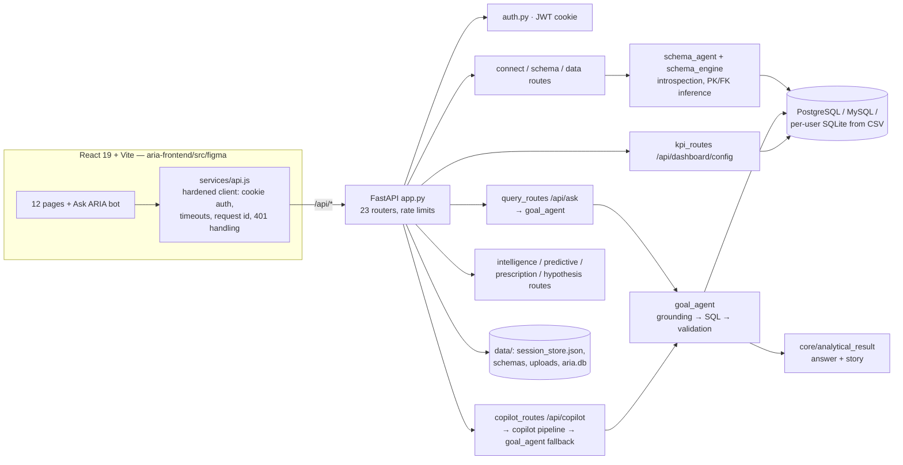

# ARIA Wiring Audit Report

**Date:** 2026-10-20 (audit) · 2026-10-21 (fixes verified) · **Branch:** `maria` (HEAD `479368e`, all changes uncommitted) · **Method:** static analysis, API checks and Playwright (Google Chrome 155) against an isolated copy of the app

> **Status (2026-10-21): every finding in §5 is fixed and verified, except the
> items listed under "Open" in §0.** §1–§7 below are the original audit,
> kept unchanged as the "before" picture.

---

## 0. Fix round results (before → after)

| Check | Before fixes | After fixes |
|---|---|---|
| Audit Playwright tests (15, now 21) | 12 passed, 3 failed | ✅ **21 passed** (incl. Ask ARIA Dashboard, Prescriptions ×3, PDF tests; one records the document-Q&A gap as an expected failure) |
| Shorthand (`amt`, `qty`) and math jargon on pages | Not checked | ✅ **None** on every page × theme × dataset, and in the expanded Forecast details |
| Pages × light/dark × datasets A/B/C, raw database names | Shown on Forecast, Dashboard, Insights, Intelligence | ✅ **None** |
| Team's existing Playwright tests (49) | 2 passed, 7 failed, 40 skipped | ✅ **48 passed in a full run; the 49th (Reports PDF) passes on its own.** In a full run it is rate-limited, see Open #1 |
| Backend tests | 745 passed | ✅ **749 passed** (4 new regression tests) |
| Lint / typecheck / build | Clean | ✅ Clean |
| `npm run audit:high` | ❌ 1 high (Vite dev server, GHSA-698v / r825 / 587h) | ✅ **0 vulnerabilities** (Vite 8.2.1 → 8.3.5, lockfile only) |

### What was fixed

| ID | Finding | Fix | Files |
|---|---|---|---|
| H1 | Reload signed the user out | A valid session restores the app on boot | `aria-frontend/src/figma/App.tsx` |
| H2 | Shorthand dates (`txn_dt`) ignored; "monthly total" returned one total | `is_date_name` expands shorthand. A period question can no longer be answered with a single total | `core/data_intelligence.py`, `core/analytical_result.py` |
| M1 | Chart header % compared with the first month, plus a fake trend on category charts | Latest vs previous period, labelled; category charts show the top group with no badge | `pages/Dashboard.tsx` |
| M2 | Forecast showed raw names and defaulted to Sub Total / Ship Date | Readable labels (setup and results); headline measure and event date first | `pages/Predictive.tsx`, `api/predictive_routes.py` |
| M3 | Team E2E suite stuck at login | Helpers follow the current auth flow; outdated locators updated; `connectSampleCsv` helper; `ARIA_E2E_ENGINE` switch | `tests/e2e/*.cjs` |
| L1 | Raw dataset/table names | `datasetLabel` in the top bar, cards, Data, Settings; plain dataset title; Intelligence "records from …" | `lib/labels.ts`, `AppShell.tsx`, `Dashboard.tsx`, `Insights.tsx`, `Data.tsx`, `Settings.tsx`, `api/kpi_routes.py`, `services/intelligence_service.py` |
| L2 | Local AI message contradicted itself | Separate "not running" and "models missing (rule engine)" messages | `api/settings_routes.py` |
| L3 | KPI card click opened an empty Analytics page | Opens Analytics and answers "How has {metric} changed over time?" | `pages/Dashboard.tsx`, `pages/AIAnalytics.tsx`, `lib/analysisContext.ts` |
| L4 | "439 groups" for 150 companies | Counts distinct groups | `services/intelligence_service.py` |
| New | Intelligence tab content could stay stuck on the previous tab after quick switches | Removed the exit-wait animation | `pages/Intelligence.tsx` |
| New | Explore offered date columns (e.g. Transaction date) as a category breakdown | Date-named columns go to the time axis only | `services/intelligence_service.py` |
| New | Ask ARIA couldn't explain the Dashboard to a confused user (it only knew the page name) | The Dashboard publishes what is on screen; the bot explains cards, charts, % changes, data quality, K/M and insights with those exact numbers, offers Dashboard starter questions, and marks such answers "Explained from what's on your screen". Data questions still go to the engine. Frontend only | `lib/screenContext.ts` (new), `pages/Dashboard.tsx`, `components/MiniAria.tsx`, audit test "ask ARIA explains the dashboard…" |
| New (24 Oct) | Forecast confidence details showed MAE / RMSE / MAPE, "Backend valid: true", raw method names | Plain English ("Typical miss", "Average miss", "Quality checks passed: Yes", "Repeat last season's pattern") | `pages/Predictive.tsx` |
| New (24 Oct) | PDF upload triggered a table-schema request that crashed the server (500) | Frontend skips the schema step for PDFs | `App.tsx` |
| Cleanup | README listed a deprecated route; misleading docstring; guessed `/connect_<type>` path | Corrected | `README.md`, `api/autocomplete_routes.py`, `App.tsx` |

### Open: needs a team decision

0. **Document questions (PDF Q&A) not on this branch.** Upload, list and search work; asking about a PDF on Copilot replies "schema not available". Maria's newer `maria` commit `92367d3` adds "Ask your documents" (`/api/documents/ask`). Merge it into `semal`. Also for Aryan: `/api/extract_schema` returns 500 (missing schema file) on a PDF connection instead of a clear 4xx (`api/schema_routes.py:39`).

1. **Rate limit too tight for normal browsing.** Most routers share one "heavy" budget: **60 requests/min per user and 240/min per IP** (`app.py:251-266`, `core/ratelimit.py:305-306`). It includes simple page reads (`GET /api/intelligence/analyses`, `/what-if/scenarios`, `/prescriptions/alerts`). Quickly moving through Intelligence tabs hit it ("Too many requests. Slow down and try again shortly."). Behind a reverse proxy, every user shares one IP, so the 240/min limit would apply to everyone together. **Suggestion:** a separate, higher budget for reads; keep the heavy budget for writes, analysis and LLM calls; use the forwarded client IP behind a trusted proxy. Owner: Aryan.
2. **Forecast time grain.** Daily data is forecast by day (730 points) while "Monthly" is shown as selected; the x-axis reads "Dec, Dec, Dec…"; the likely range can go below zero for sales. Needs a decision in the forecast engine (`prediction/agent.py` `_infer_period`). Owner: Aryan.
3. **Unused backend routes.** Delete or wire up the 14 orphaned routes (§5).
4. **Missing UI.** PDF chat screen; "Test connection" button.
5. **Not verified here:** Cloud AI (the Groq key on this computer is rejected; the QA specs ran with `ARIA_E2E_ENGINE="Local AI"`), MySQL, PDF upload/RAG, Slack.

**Rerun:**
```powershell
cd aria-frontend
npx playwright test -c playwright.audit.config.cjs --project=audit
$env:ARIA_E2E_ENGINE="Local AI"   # only if no valid Groq key
npx playwright test -c playwright.audit.config.cjs --project=existing
```

---

## 1. Summary (original audit, 2026-10-20)

| Area | Result |
|---|---|
| Frontend → backend connections | **119 distinct API calls, 0 broken.** Every call reaches an existing route with the right method |
| Backend routes | 166 operations. **43 are never called by the UI:** 14 orphaned, 17 duplicates of routes the UI uses, 12 used only by tests, CI or external callers |
| Answer correctness (Analytics, Copilot, Ask ARIA bot) | ✅ **The same correct number on all 3 datasets** (A: 1,805,810.30 · C: 1,071,222 · B: 2,141,650.33) |
| Page rendering (10 pages × light/dark × 3 datasets) | ✅ No JavaScript crashes, no 5xx errors, no NaN/undefined/null, no low-contrast headings. ⚠️ Raw database names on 3 pages |
| Audit Playwright tests (15) | **12 passed, 3 failed.** All 3 failures are real app findings, listed in §5 |
| Team's existing Playwright tests (49) | **2 passed, 7 failed, 40 skipped.** All failures are outdated test code, not app bugs (§4.3) |
| Bugs found | **2 high, 3 medium, 4 low** (§5) |

---

## 2. Scope, safety and what was not verified

**Safety:**
- No application code was changed during this audit. Only new test files were created (§7).
- Tests ran against a **throwaway copy of the code with an empty `data/` folder** on `:8000`, plus a **throwaway PostgreSQL** on `:55432`. Both were deleted afterwards.
- Production and local user data were not read or written. Only synthetic datasets were used (`work/datasets/`).

**Datasets:**
- **A:** snake_case CSV, 2,000 rows
- **B:** CamelCase PostgreSQL, 2 schemas, 4 related tables
- **C:** shorthand CSV (`amt`, `qty`, `txn_dt`), 1,500 rows, with blank and `N/A` values

Correct answers are in `work/datasets/expected_answers.json`.

**Not verified:**
- **Cloud AI (Groq):** the configured key is rejected (401), so all AI-model paths ran in Local mode. Local mode answered through the rule-based engine, because the Ollama models `aria-sql-mistral`, `aria-story-mistral` and `aria-goal` are not installed.
- **MySQL** connections: no test server was available.
- **PDF upload, Documents search and RAG answers:** no PDF dataset was used.
- **Slack integration, webhooks and notifications:** external services.
- **Multi-worker / Redis mode.**
- **Report PDF export:** the button exists, but the output was not checked.
- **Forecast results:** the setup screen rendered, but forecast accuracy was not checked against known values.
- The **"439 groups"** label in Intelligence Explore (§5, L4) was observed but not traced.

---

## 3. Architecture and data flow



**How a question flows (verified end to end):**
1. The page calls `POST /api/ask` (Analytics) or `/api/copilot` (Copilot page and bot).
2. `goal_agent` matches the words in the question to tables and columns, using shorthand and synonyms.
3. It builds the SQL from rules, because the AI models aren't available here.
4. It runs the SQL as read-only.
5. `analyze_result` writes the answer.
6. The page shows the answer, follow-up questions and Show SQL.

**How connecting data flows:** `POST /api/connect_file` (CSV) or `POST /api/connect` (database) → schema mapping saved under `data/schemas/user_N/` → the session points to the data. The UI only picks up an existing connection when it starts up after a sign-in (see H1).

---

## 4. Test results

### 4.1 Audit tests: `tests/e2e/audit/` (15 tests)

| Test | Result | Notes |
|---|---|---|
| Pages × light × dataset A | ❌ | Only failure: Forecast shows raw names (M2) |
| Pages × dark × dataset A | ❌ | Same as light |
| Pages × light × dataset C | ❌ | Raw dataset name `dataset_c_messy_txns` on Dashboard, Insights, Intelligence (L1) |
| Pages × dark × dataset C | ❌ | Same as light |
| Pages × light × dataset B | ❌ | Forecast raw names (M2), plus `SalesOrderDetail` on Intelligence (L1) |
| Pages × dark × dataset B | ❌ | Same as light |
| Login: register, sign out, wrong password, sign in, **reload** | ❌ | Every step passes **except staying signed in after a reload** (H1) |
| Upload a CSV through the Data page, open every Data tab | ✅ | |
| Analytics: autocomplete, correct answer, Show SQL, follow-up | ❌ | Autocomplete ✅, answer 1,071,222 ✅, Show SQL ✅. **The follow-up ARIA suggested fails** (H2) |
| Ask ARIA + Copilot + Analytics agree, dataset A | ✅ | 1,805,810.30 on all three |
| Same, dataset C | ✅ | 1,071,222 |
| Same, dataset B (PostgreSQL) | ✅ | 2,141,650.33 |
| Dashboard cards + "Ask about this →" handoff | ✅ | Total Amount, 1,500 records, handoff answers 1,071,222 |
| Intelligence: all 6 tabs + Explore run | ✅ | Explore totals check out: 5,146 + 5,247 = 10,393 order qty |
| Forecast, Insights, Documents, History, Settings (all tabs), profile save, dark theme kept after reload | ✅ | |

In the 6 page-matrix tests, the **only** problems found were raw identifiers. All 60 page × theme × dataset combinations had **zero** JavaScript errors, server errors, NaN/null tokens and low-contrast headings.

### 4.2 How the failures were classified

The audit tests themselves had problems at first, all fixed before the final run:
- an outdated username format,
- testing pages before the data had loaded,
- two locators that didn't match the real buttons (`Show SQL` uses `aria-label="Show the SQL behind this answer"`; the KPI card's accessible name contains its button's label).

Only failures that reproduced after those fixes are reported as app bugs.

### 4.3 Team's existing tests: `tests/e2e/*.spec.cjs` (49 tests)

**2 passed, 7 failed, 40 skipped** (serial blocks skip once their first test fails). None of the failures is an app bug:

| Spec | Cause |
|---|---|
| `02-figma-pages`, `03-main-pages`, `04-data-connect`, `full-journey`, `intelligence` | `tests/e2e/auth-helper.cjs:12` registers `user + 'aria.test'`. The app now maps emails as `@` → `_at_` (`src/utils/authStorage.js:48`), so login fails with "Invalid username or password" |
| `qa-all-pages`, `qa-connected-flow` | They expect registering to return to the login form (`qa-all-pages.spec.cjs:52-56`). The app now signs the user in straight after registering |

**Impact:** the existing end-to-end suite can't currently check anything past login.

---

## 5. Bugs, by severity

### 🔴 High

**H1. Refreshing the page signs the user out.**
- **Where:** `aria-frontend/src/figma/App.tsx:94` (the stage always starts as `"login"`) and `App.tsx:146-176`. The startup check calls `/session/status`, confirms a valid session and restores the connection, but never sets the stage back to `"app"`.
- **Evidence:**
  - The login cookie is valid (`aria_token`, HttpOnly, Max-Age 86400).
  - The audit login test fails only at "session survives a reload".
  - The code comment at `App.tsx:167-170` says reloads should keep the user in.
- **Fix:** when `/session/status` succeeds, restore the user and LLM mode, then `setAppStage("app")`. Keep the login screen only for a 401.

**H2. Time questions ignore date columns with shorthand names, and some return a wrong answer that looks right.**
- **Where:**
  - `core/data_intelligence.py:50`: `_DATE_NAME_HINTS` has no shorthand such as `dt` or `ts`.
  - `core/data_intelligence.py:211`: `classify_column` ignores the profiler's own `column_classes` (which already says `txn_dt: "date"`).
- **Evidence on dataset C:**
  - `_classify_column("txn_dt")` returns `"text"`.
  - "monthly total amount" runs `SELECT SUM("amt")` and returns the **overall total** as if it answered the question.
  - "How has amount changed over time", which **ARIA itself suggests**, answers "This data has no time or date column".
  - The Dashboard *does* treat `txn_dt` as a date ("Amount by Month").
- **Fix:** use the profiled `column_classes` first. Also recognise shorthand date words (`dt`, `ts`) using the shared `schema_engine.lexical.identifier_words`.

### 🟠 Medium

**M1. Dashboard chart headers show misleading % changes.**
- **Where:** `aria-frontend/src/figma/pages/Dashboard.tsx:484-489` (`trendOf`, which compares the last value with the **first**), `:551-552`, and the badge at `:933-936`.
- **Evidence on dataset C:**
  - "Amount by Month" shows **34.0K ↘45.6%**, which is December 2025 against **January 2024**, without saying so. The Total Amount card shows ↘1% (month over month, correct) and the insight below says −20.1%.
  - "Top 4 Product Category by Amount" shows **15.8K ↘96.6%**: the *smallest* category compared with the largest, presented as a decline.
- **Fix:**
  - For time charts, label the comparison ("since Jan 2024"), or use the same period-over-period change as the KPI card.
  - For category charts, show the top value (or the total) and no trend badge.

**M2. Forecast setup shows raw database names and picks poor defaults.**
- **Where:** `aria-frontend/src/figma/pages/Predictive.tsx:1226` (dataset: `{t.table} ({rows} rows)`), `:1242` (metric `{m}`), `:1255` (date field `{d.column}`), `:1399` ("Time base: {timeName}").
- **Evidence:**
  - Dataset B shows `sales.SalesOrderHeader (1200 rows)`, `SubTotal`, `ShipDate`, `OrderDate`.
  - Dataset A shows `order_date`, `total_amount` and so on.
  - It defaults to **Sub Total** and **Ship Date**, not the headline **Total Due** and **Order Date**.
- **Fix:** show `humanizeLabel(...)` (`figma/lib/labels.ts`) while keeping the raw names as option values. Default to the same headline measure the Dashboard uses.

**M3. The team's E2E suite is out of date (§4.3).**
- **Where:** `tests/e2e/auth-helper.cjs:12`, `tests/e2e/qa-all-pages.spec.cjs:52-56`, `qa-connected-flow.spec.cjs`.
- **Fix:** build the username exactly like `toBackendUsername`, and expect registering to sign the user in directly.

### 🟡 Low

**L1. Raw identifiers appear in page text.**
- The dataset name `dataset_c_messy_txns` appears on Dashboard ("Data Analysis: …", the "Connected Data" card), Insights and Intelligence.
- `SalesOrderDetail` appears in Intelligence Explore (dataset B).
- **Fix:** show the humanized dataset name ("Dataset C messy transactions").

**L2. The Local AI status contradicts itself and is misleading.**
- **Where:** `api/settings_routes.py:147`.
- **Evidence:** it reads "Ollama is not reachable (Ollama runs but none of the ARIA models are installed.)" and labels Local "Unavailable", although Local mode works through the rule-based engine.
- **Fix:** separate "Ollama not running" from "models missing (rule-based answers only)".

**L3. Clicking a KPI card opens Analytics with nothing about that metric.**
- **Where:** `Dashboard.tsx:1427` (`drillKpi` saves the drill context and switches page).
- **Evidence:** Analytics showed the default empty state, with no sign of the metric.
- **Note:** possibly by design (only Intelligence Explore reads that context). Confirm the intended behaviour.

**L4. Intelligence Explore says "439 groups" for "Company name" on dataset B**, which has only 150 companies. Not traced. Possibly company × period rows.

### Backend routes no page uses (static analysis, verified by spot checks)

| Kind | Routes | Recommendation |
|---|---|---|
| **Orphaned (14)** | Hypothesis API: `/api/hypotheses/{auto,context,investigate,investigation,parse}`, `/api/hypothesis/{analyze,suggest}`. Also `/api/chart/recommend`, `/api/feedback/{chart,insight}`, `/api/preferences` (GET and POST), `/api/conversation/{store,resolve_followup}`, `/api/dashboard/{summary,summaries}`, `/api/database/test` | Remove, or wire up deliberately |
| **Duplicate (17)** | `/api/verify/*` (verdicts already attached to `/ask`, `/dashboard/config`, forecast and prescriptions), `/api/connect/{postgresql,mysql}`, `/api/extract_schema/{postgresql,mysql}`, `/api/insight/pdf/{documents, upload, delete}`, `/api/dashboard/{kpis,real_kpis}`, `/api/intelligence/refresh`, `/api/settings/models`, `/api/upload/progress/stream`, `/api/prescription/generate` (marked DEPRECATED, `api/predictive_routes.py:1592`, but still listed in `README.md:68`) | Keep only for API clients, otherwise remove |
| **API-only (12)** | `/api/health` (CI), `/api/auth/me`, `/api/rl/{event,events,rank,status}`, `/api/insight/pdf/{chat,health}`, `/api/integrations/slack/command` | Fine as is |

**Structural gaps:**
- **Two conversation memories:** `/api/conversation/*` uses `session["conversation"]`, while `/api/ask` uses `conversation_history`. The docstring at `api/autocomplete_routes.py:772` wrongly says the frontend calls it.
- **The preference/RL loop gets almost no signal:** `/chart/recommend` reads `chart_type_history`, which nothing writes.
- **No PDF chat screen**, although `/api/insight/pdf/chat` exists and is tested.
- **No "Test connection" step** before connecting, although `/api/database/test` exists, with host validation.
- `App.tsx:447` builds `/connect_${sourceType}` for any unknown type, which would produce a path that doesn't exist.

---

## 6. Recommended fix order

1. **H1** (refresh signs out): a small change in `App.tsx`, and it affects every user.
2. **H2** (shorthand dates): gives wrong answers that look right; also fixes ARIA's own broken suggestion.
3. **M3** (update the E2E helper and the 2 QA specs): restores the team's regression safety net.
4. **M1** (chart header %): numbers that contradict each other on the same screen.
5. **M2 + L1** (raw names in Forecast and dataset labels): use the existing `humanizeLabel`.
6. **L2–L4**, then route clean-up (remove or document orphaned and deprecated routes; fix `README.md:68`).

---

## 7. Test assets added (no existing files changed)

| File | Purpose |
|---|---|
| `aria-frontend/playwright.audit.config.cjs` | Audit config: system Chrome, `audit` and `existing` projects |
| `aria-frontend/tests/e2e/audit/helpers.cjs` | Login, dataset connect, error capture, text-hygiene and contrast checks |
| `aria-frontend/tests/e2e/audit/01-pages-matrix.spec.cjs` | Every page × light/dark × datasets A/B/C, with screenshots |
| `aria-frontend/tests/e2e/audit/02-workflows.spec.cjs` | End-to-end journeys checked against the known correct answers |

**How to rerun** (only against an isolated server, because the tests create accounts):
```powershell
cd aria-frontend
npx playwright test -c playwright.audit.config.cjs --project=audit      # audit
npx playwright test -c playwright.audit.config.cjs --project=existing   # team specs
# Dataset B needs PostgreSQL on :55432 with db aria_test (work/datasets/dataset_B_postgres.sql)
```

The screenshots for every page × theme × dataset are in `aria-frontend/test-results-matrix/`.

---

*Decision-support only: these findings should be reviewed by the responsible engineers before changes are made.*
